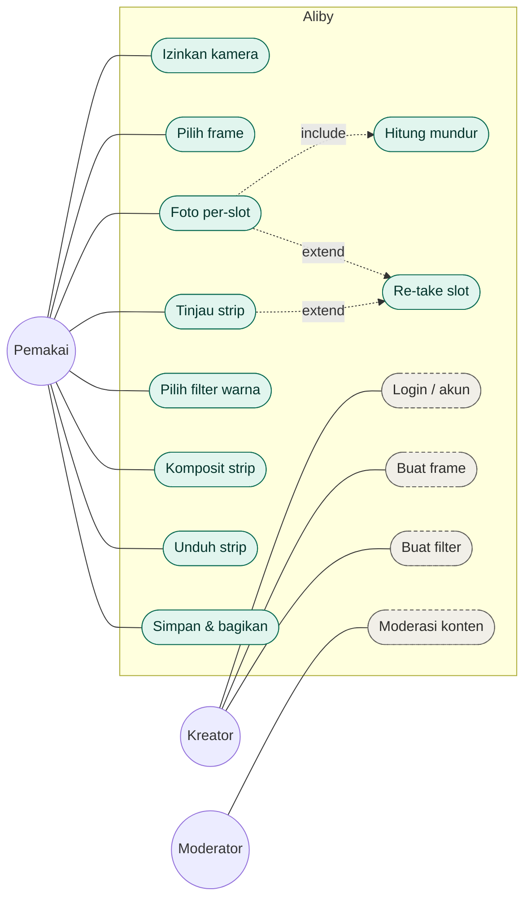
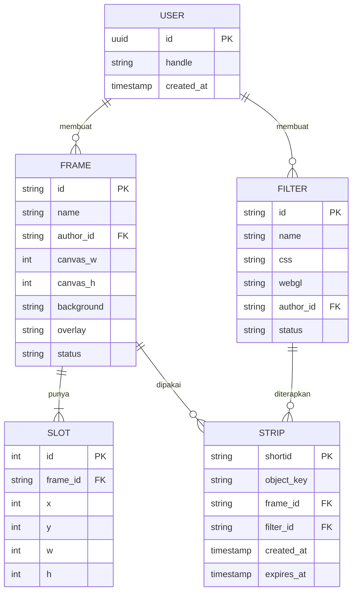
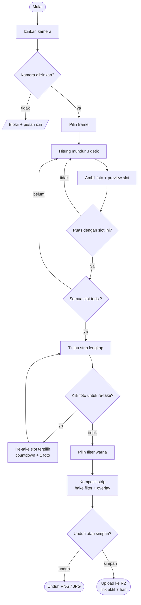

# Aliby — Diagram Sistem

**Turunan dari `PRD-Aliby.md` (v0.1) · dibekukan 24 September 2026**

Dokumen ini merekam tiga diagram untuk memahami sistem Aliby. Semua diagram ditulis sebagai blok [Mermaid](https://mermaid.js.org/) — bisa diedit langsung dan dirender otomatis di GitHub, GitLab, dan VS Code (ekstensi *Markdown Preview Mermaid*).

> **Konteks penting:** di **v1 (MVP)** belum ada database. `Frame`, `Slot`, dan `Filter` hidup sebagai file JSON statis; `Strip` cuma objek `.jpg` di Cloudflare R2. Skema relasional pada ERD di bawah adalah *model data logis* yang baru jadi tabel Postgres beneran saat fitur **UGC** (user bikin frame/filter sendiri) dibuka. Bagian pasca-MVP ditandai jelas di tiap diagram.

---

## 1. Use Case Diagram

Aktor digambar sebagai lingkaran, use case sebagai kapsul. Aktor **Pemakai** memikul seluruh alur v1. Aktor **Kreator** dan **Moderator** baru relevan saat UGC.

**Keterangan**

- Hijau = use case **v1 (MVP)**; abu-abu garis putus-putus = **pasca-MVP (UGC)**.
- `Hitung mundur` adalah **«include»** dari `Foto per-slot` — selalu terjadi tiap kali menjepret.
- `Re-take slot` adalah **«extend»** dari **dua** use case: `Foto per-slot` (saat capture) dan `Tinjau strip` (klik foto di preview akhir). Keduanya operasi yang sama — timpa satu entri foto lalu re-composite.
- Manajemen booth/sewa **tidak ada** dan tidak akan pernah masuk (garis pembeda dari Jepreto).

---

## 2. ERD — Model Data

Model data logis. Di v1 `Frame`/`Slot`/`Filter` = JSON dan `Strip` = objek R2; entitas `User` beserta kolom `author_id` & `status` baru aktif saat UGC.

**Keterangan kardinalitas**

- `FRAME ||--|{ SLOT` — satu frame **wajib** punya minimal satu slot. Inilah aturan **jumlah slot = jumlah shot**.
- `USER ||--o{ FRAME` (lingkaran = *optional*) — seorang user bisa saja belum bikin frame apa pun.
- `STRIP` menyimpan `frame_id` & `filter_id` sebagai jejak yang dipakai. Di v1 ini cukup jadi *custom metadata* objek R2; `expires_at` ditangani **lifecycle rule R2** (auto-hapus 7 hari), bukan kode.

---

## 3. Activity Diagram — Alur Capture

Alur inti dari izin kamera sampai simpan/unduh. Ada **dua titik re-take**: langsung per-slot saat capture, dan klik foto di tinjau strip lengkap.

**Keterangan**

- **Loop capture** — `Puas?` yang gagal mengulang slot yang sama; `Semua slot terisi?` yang belum lanjut ke slot berikutnya. Keduanya kembali ke `Hitung mundur`.
- **Tinjau strip** adalah state interaktif: tiap slot bisa diklik untuk re-take, lalu kembali ke tinjau (bukan lanjut otomatis). Beri affordance visual (border menyala + ikon ulangi) supaya jelas foto bisa diklik.
- Filter dipilih **sekali** setelah semua slot beres, lalu di-*bake* saat komposit.
- Satu-satunya langkah yang menyentuh backend adalah **Upload ke R2**.

---

*Dokumen ini turunan dari blueprint dan ikut berubah saat asumsi berubah. Perbarui berbarengan dengan `PRD-Aliby.md`.*
