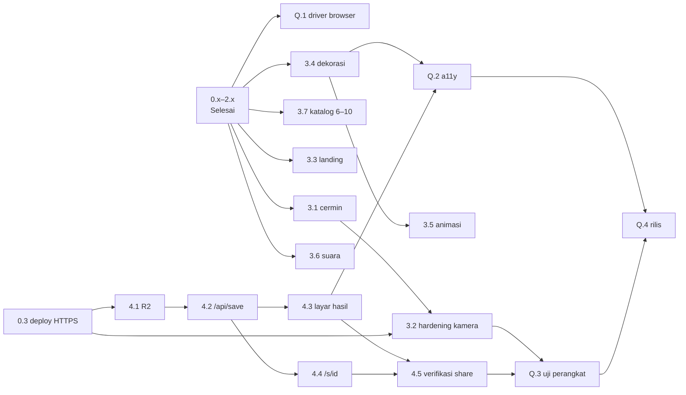

# Aliby — Work Breakdown Structure

**Turunan dari `PRD-Aliby.md` v0.1 §9 · disusun 20 Oktober 2026**

WBS ini memecah MVP Aliby (Phase 0–4 PRD) menjadi paket kerja (WP) yang masing-masing bisa dikerjakan
**dalam satu sesi** dan dibuktikan selesai. Ini input untuk skill `/kerjakan-wp <kode>`.

| Dokumen | Isi |
|---|---|
| [`aliby-kebutuhan.md`](aliby-kebutuhan.md) | Kode kebutuhan (KAM, CAP, FRM, FLT, KOM, SHR, UX, DEP) + daftar di luar lingkup |
| [`aliby-keputusan.md`](aliby-keputusan.md) | Keputusan mengikat (K-xx) dan pertanyaan terbuka (OQ-xx) |
| [`aliby-progress.md`](aliby-progress.md) | Status tiap WP + log sesi |

## 1. Prinsip penyusunan

- **Aturan 100%.** Setiap kode kebutuhan dipetakan ke minimal satu WP (lihat §5). Tidak ada WP yang mengerjakan
  sesuatu di luar `aliby-kebutuhan.md`.
- **Satu WP = satu sesi = satu hasil yang bisa dicek.** Ukuran: **S** ≤ 1 malam · **M** 1–2 malam · **L** satu
  weekend. WP yang lebih besar dari L dipecah.
- **Level 1 = fase PRD** (0–4), plus jalur **Q** (mutu & rilis) yang memotong fase. Level 2 = WP.
  Phase 5+ PRD tidak punya WP: semuanya di luar MVP.
- **Mode tiap WP** menentukan siapa yang menulis kode (aturan `CLAUDE.md` §Cara bekerja, K-11):

  | Mode | Agen menulis | Pemilik proyek menulis / melakukan |
  |---|---|---|
  | **Agen** | Implementasi + test | Menyetujui rencana, menguji hasilnya |
  | **Pembimbing** | Tipe, test (sebagai spesifikasi), stub `TODO(pembimbing)`, kode pemanggil, review | Implementasi bagian pembimbing |
  | **Manusia** | Checklist, `.env.example`, pemeriksaan hasil yang dilaporkan | Aksi di dashboard/perangkat fisik |
  | **Campuran** | Bagian Agen sesuai rincian WP | Bagian Pembimbing/Manusia sesuai rincian WP |

- **Test minimum** adalah batas bawah. Nama test diawali kode kebutuhan. Yang butuh Canvas/kamera di-*skip*
  di Node (K-10) dan dibuktikan lewat **bukti browser**.

## 2. Hierarki

```
Aliby MVP
├── 0  Setup ............................................ Selesai*
│   ├── 0.1  Repo, Next.js 16 + TS + Tailwind v4, lint, test runner
│   ├── 0.2  Design token & font scrapbook
│   └── 0.3  Deploy skeleton ke Vercel (HTTPS) ............ *perlu konfirmasi (OQ-16)
├── 1  Vertical slice ................................... Selesai
│   ├── 1.1  Tipe & validasi manifest frame + zona watermark
│   ├── 1.2  Hook kamera ................................. [Pembimbing]
│   ├── 1.3  Reducer alur capture (countdown, per-slot, ulangi)
│   ├── 1.4  Komposit strip & unduh ...................... [Pembimbing]
│   └── 1.5  Layar capture, tinjau, konfirmasi ulangi
├── 2  Filter & multi-frame ............................. Selesai
│   ├── 2.1  Katalog frame dari manifest (3 frame)
│   ├── 2.2  Katalog & validasi filter (allowlist)
│   ├── 2.3  Layar pilih frame
│   └── 2.4  Layar pilih filter + bake saat komposit
├── 3  Polish & mobile hardening
│   ├── 3.1  Cermin kamera depan ......................... [Campuran]
│   ├── 3.2  Hardening kamera iOS Safari & Android ....... [Pembimbing + Manusia]
│   ├── 3.3  Landing "bukti kamu di sana"
│   ├── 3.4  Dekorasi scrapbook per layar
│   ├── 3.5  Animasi & transisi
│   ├── 3.6  Suara countdown & shutter
│   └── 3.7  Perluasan katalog frame ke 6–10 ............. [Campuran]
├── 4  Save & share
│   ├── 4.1  Infrastruktur R2 (bucket, CORS, lifecycle 7 hari) [Manusia]
│   ├── 4.2  Route handler /api/save (presigned PUT) ..... [Pembimbing]
│   ├── 4.3  Layar Hasil + "Simpan & dapat link"
│   ├── 4.4  Halaman share /s/{shortid} + OG preview
│   └── 4.5  Verifikasi simpan & bagikan di Vercel ........ [Manusia + Agen]
├── Q  Mutu & rilis
│   ├── Q.1  Driver verifikasi browser masuk repo
│   ├── Q.2  Audit aksesibilitas & kontras
│   ├── Q.3  Uji perangkat nyata & metrik sukses ......... [Manusia]
│   └── Q.4  Rilis MVP ................................... [Manusia + Agen]
└── 5+ Lanjutan (WebGL, UGC, auth, moderasi, AR) ......... di luar MVP — tidak ada WP
```

## 3. Urutan & ketergantungan



**Antrian disarankan:** Q.1 → 3.1 → 3.2 → 3.7 → 3.3 → 3.4 → 3.5 → 3.6 → 4.1 → 4.2 → 4.3 → 4.4 → 4.5 → Q.2 → Q.3 → Q.4.

Alasannya: Q.1 lebih dulu karena setiap WP UI sesudahnya butuh bukti browser yang bisa diulang. Kamera
(3.1–3.2) didahulukan karena PRD §9 menyebutnya "yang terpenting" di Phase 3 dan §11 menyebutnya risiko
terbesar soal waktu. Katalog frame (3.7) sebelum dekorasi supaya dekorasi diuji pada semua bentuk frame.

---

## 4. Kamus paket kerja

### 4.0 WP yang sudah selesai (dicatat untuk keterlacakan)

| WP | Mode | Cakupan | Bukti |
|---|---|---|---|
| 0.1 | Agen | — (fondasi) | `npm test`, `npm run lint`, `npx tsc --noEmit` jalan |
| 0.2 | Agen | UX-01 · K-08, K-09 | `app/globals.css`, `app/layout.tsx`, halaman bukti token di `/` |
| 0.3 | Manusia | DEP-01, KAM-03 | **Belum terbukti** — butuh URL Vercel (OQ-16) |
| 1.1 | Agen | FRM-01, FRM-03 | `lib/frames/parseFrameManifest.ts` + test |
| 1.2 | Pembimbing | KAM-01..04, KAM-07 · K-06 | `lib/camera/useCamera.ts`; bukti browser di README §Status |
| 1.3 | Agen | CAP-01..05 | `lib/capture/captureReducer.ts` + test |
| 1.4 | Pembimbing | KOM-01, KOM-02 | `lib/composite/compositeStrip.ts`; test canvas di-*skip* di Node, bukti piksel di README |
| 1.5 | Agen | CAP-01, CAP-03, CAP-04, UX-04 | `components/booth/{CaptureScreen,ReviewScreen,RetakeSheet,CountdownBadge,SlotIndicator}.tsx` |
| 2.1 | Agen | FRM-02, FRM-04 · K-04 | `lib/frames/loadFrame.ts` + test katalog `public/` |
| 2.2 | Agen | FLT-01, FLT-02, FLT-05 · K-05 | `lib/filters/*` + test |
| 2.3 | Agen | FRM-06 | `components/booth/FramePicker.tsx` |
| 2.4 | Agen + Pembimbing | FLT-03, FLT-04, FLT-06 · K-07 | `components/booth/FilterScreen.tsx`; tabel piksel Asli vs Hitam Putih di README |

Baseline test 20/10/2026: **78 lulus, 5 di-skip (canvas), 0 gagal**; lint dan type-check bersih.

---

### 3.1 Cermin kamera depan · Campuran · S

- **Cakupan:** KAM-05 · KAM-04 (konsistensi pratinjau ↔ hasil).
- **Prasyarat:** 1.2 · **OQ-03 wajib dijawab** (hasil ikut dicerminkan atau tidak).
- **Hasil:** pratinjau kamera depan terbaca seperti cermin; kamera belakang tidak. Foto yang masuk slot
  mengikuti jawaban OQ-03.
- **Bagian agen:** helper murni `shouldMirror(facingMode)`; `transform: scaleX(-1)` pada `<video>` di
  `CaptureScreen` saat kamera depan; pratinjau setelah jepret konsisten dengan OQ-03.
- **Bagian pembimbing:** bila OQ-03 = hasil ikut dicerminkan → flip horizontal di `grabFrame`
  (`useCamera.ts`). Agen menjelaskan konsep transform canvas, tidak menulis kodenya.
- **Bukan cakupan:** orientasi/rotasi (3.2); mencerminkan kamera belakang.
- **File:** `components/booth/CaptureScreen.tsx`, `lib/camera/mirror.ts` (baru), `lib/camera/mirror.test.ts`
  (baru), `lib/camera/useCamera.ts` (pembimbing).
- **Test minimum:** `KAM-05 kamera depan dicerminkan` · `KAM-05 kamera belakang tidak dicerminkan`.
- **Bukti browser:** fake device Chrome menampilkan angka penghitung. Angkanya terbalik di pratinjau
  kamera depan; di strip unduhan sesuai OQ-03. Ganti ke kamera belakang → tidak terbalik.

### 3.2 Hardening kamera iOS Safari & Android · Pembimbing + Manusia · L

- **Cakupan:** KAM-06, KAM-08 · KAM-04, KAM-07 (regresi).
- **Prasyarat:** 3.1 · 0.3 (HTTPS untuk uji di HP; tunnel juga boleh).
- **Hasil:** alur capture lolos matriks uji perangkat di bawah, di iPhone (Safari) dan Android mid-range (Chrome).
- **Bagian agen:** (1) test spesifikasi untuk helper crop tengah murni
  `centerCrop(videoW, videoH, targetRatio) → {sx, sy, sw, sh}`, yang diekstrak pemilik proyek dari
  `grabFrame`; (2) matriks uji perangkat; (3) review kode hook dengan pertanyaan lebih dulu; (4) perbaikan di
  komponen pemanggil (`CaptureScreen`, `app/booth/page.tsx`) bila masalahnya di sana.
- **Bagian pembimbing:** hook kamera — stream yang berakhir saat tab di-background (`track.onended`,
  `visibilitychange`), ganti kamera di iOS (track lama dihentikan sebelum `getUserMedia` baru), rotasi HP saat
  capture, resolusi ideal vs perf.
- **Bagian manusia:** menjalankan matriks di perangkat nyata dan melaporkan hasil per baris.
- **Bukan cakupan:** filter WebGL; mengganti strategi kamera ke library.
- **Test minimum:** `KAM-04 centerCrop landscape 1280×720 ke 520/360` · `KAM-04 centerCrop potret 720×1280
  ke 520/360` · `KAM-04 centerCrop potret ke 520/640` · `KAM-04 rasio sama → tanpa crop` ·
  `KAM-04 hasil crop selalu di dalam video (sx+sw ≤ vw, sy+sh ≤ vh)`.
- **Matriks uji perangkat** (per perangkat, isi lulus/gagal + catatan):
  izin pertama · izin ditolak lalu diizinkan · ganti depan/belakang 3× · putar HP saat countdown ·
  pindah tab lalu kembali · kunci layar lalu buka · 4 slot + ulangi 1 slot dari tinjau · unduh · lampu kamera
  mati di layar tinjau/filter · countdown tidak patah-patah.

### 3.3 Landing "bukti kamu di sana" · Agen · M

- **Cakupan:** UX-10 · UX-01, UX-02 (maksimal), UX-03, UX-05, UX-07.
- **Prasyarat:** 0.2 · **OQ-08 wajib dijawab** (nasib halaman bukti token).
- **Hasil:** `/` menjadi landing: wordmark, tagline (PRD §12 / README), konsep alibi, satu CTA jelas ke
  `/booth`, contoh strip yang dirender dari manifest (bukan screenshot). Judul halaman "Aliby — photo booth".
- **Bukan cakupan:** galeri, testimonial, form email, login, pemilihan domain.
- **File:** `app/page.tsx`, `app/layout.tsx` (metadata), komponen landing baru di `components/landing/`.
- **Test minimum:** tidak ada logika murni baru → wajib bukti browser.
- **Bukti browser:** screenshot 360 px dan 1280 px; ketuk CTA → `/booth`; dekorasi ≤ batas UX-03; tidak ada
  literal warna di file yang diubah (`grep -nE '#[0-9a-fA-F]{3,8}\b|rgba?\(' <file>` kosong).

### 3.4 Dekorasi scrapbook per layar · Agen · L

- **Cakupan:** UX-02, UX-03, UX-04, UX-06 · UX-01.
- **Prasyarat:** 2.3, 2.4 · daftar aset handoff "Aliby Scrapbook" Revisi 3 tersedia (bila tidak ada di repo,
  minta pemilik proyek; jangan menebak aset).
- **Hasil:** pilih frame (maksimal), tinjau (sedang), filter (sedang), capture (minimal) memakai tekstur dan
  dekorasi sesuai handoff, dalam batas UX-03. Layar Hasil menyusul di 4.3.
- **Bukan cakupan:** animasi (3.5); aset gambar di luar daftar aset; layar yang belum ada.
- **File:** `components/booth/*.tsx`, `components/ui/*`, `app/globals.css` (token/utility baru bila perlu).
- **Test minimum:** tidak ada logika murni baru → bukti browser.
- **Bukti browser:** screenshot tiap layar di 360 px dan 1280 px dengan tabel hitungan dekorasi per layar
  (sticky / washi / benang); di capture, kamera + countdown + indikator slot tidak tertutup; cek literal warna
  seperti 3.3.

### 3.5 Animasi & transisi · Agen · M

- **Cakupan:** UX-08 · UX-04 (tidak boleh menutupi kamera/countdown).
- **Prasyarat:** 3.4 · OQ-06 (default sementara).
- **Hasil:** transisi antar fase booth, countdown "pop", kilatan saat jepret, foto masuk ke slot. Hanya
  `transform`/`opacity`; durasi dan easing sebagai token di `globals.css`.
- **Bukan cakupan:** library animasi (K-12); animasi yang memperlambat jepretan.
- **File:** `app/globals.css`, `components/booth/*.tsx`.
- **Test minimum:** tidak ada logika murni baru → bukti browser.
- **Bukti browser:** rekam/tangkap tiap transisi; dengan `prefers-reduced-motion: reduce` diemulasi, animasi
  dekoratif mati dan countdown tetap terbaca (OQ-06); waktu dari angka 0 sampai foto masuk state tidak
  bertambah dibanding sebelum WP.

### 3.6 Suara countdown & shutter · Agen · M

- **Cakupan:** UX-09 · UX-04 (tombol bisu tidak menutupi kamera).
- **Prasyarat:** 1.5 · OQ-04, OQ-05 (default sementara).
- **Hasil:** bunyi tick tiap detik countdown dan bunyi shutter saat jepret, disintesis Web Audio; satu tombol
  bisu kecil di layar capture; preferensi bisu bertahan antar kunjungan.
- **Bukan cakupan:** file audio; musik latar; getaran (vibrate).
- **File:** `lib/sound/` (baru), `components/booth/CaptureScreen.tsx`.
- **Test minimum:** `UX-09 jadwal bunyi: tick di 3,2,1 dan shutter di 0` · `UX-09 bisu → tidak ada bunyi` ·
  `UX-09 preferensi tersimpan rusak/kosong → default` · `UX-09 AudioContext tidak ada → diam tanpa error`.
- **Bukti browser:** `AudioContext` dibuat setelah interaksi user, bukan saat halaman dimuat; uji dengar
  manual di HP (catat: switch silent iOS ikut membisukan Web Audio).

### 3.7 Perluasan katalog frame ke 6–10 · Campuran · M

- **Cakupan:** FRM-05 · FRM-01..04 · K-01, K-04.
- **Prasyarat:** 2.1 · **OQ-07 wajib dijawab** (aset overlay) · OQ-01.
- **Hasil:** 6–10 frame di `public/frames/`, semuanya lolos validasi dan bisa dipakai penuh.
- **Bagian manusia:** menyediakan overlay PNG (atau sumber asetnya) dan geometri slot yang diinginkan.
- **Bagian agen:** manifest JSON, `index.json`, test katalog. **Tidak ada perubahan kode komponen.** Bila
  frame baru ternyata butuh perubahan kode, itu bug engine (K-01) → berhenti dan laporkan.
- **Bukan cakupan:** menggambar overlay baru; editor frame.
- **File:** `public/frames/*.json`, `public/frames/*.png`, `public/frames/index.json`,
  `lib/frames/loadFrame.test.ts`.
- **Test minimum:** `FRM-05 katalog berisi 6–10 frame` · `FRM-02 semua manifest lolos validasi` ·
  `FRM-01 overlay tiap frame ada dan ukuran PNG = canvas` (baca header IHDR, tanpa dependency) ·
  `FRM-04 id dan nama unik` · `FRM-03 tidak ada slot di pita watermark`.
- **Bukti browser:** tabel per frame seperti README §Status (slot, canvas, ukuran foto, rasio viewport vs slot).

### 4.1 Infrastruktur R2 · Manusia · S

- **Cakupan:** SHR-03 · persiapan SHR-01, SHR-04.
- **Prasyarat:** 0.3 · **OQ-11 wajib dijawab** (akses baca publik).
- **Bagian manusia:** bucket R2; lifecycle rule prefix `strips/` hapus setelah 7 hari; CORS mengizinkan `PUT`
  dari origin dev + Vercel dengan header `Content-Type`; API token khusus bucket ini (Object Read & Write);
  akses baca publik sesuai OQ-11; env di Vercel (Preview + Production).
- **Bagian agen:** checklist langkah demi langkah; `.env.example` berisi **nama** variabel tanpa nilai
  (perhatikan `.gitignore` sekarang mengabaikan `.env*`, jadi perlu pengecualian `!.env.example`); update
  README §Deploy.
- **Bukan cakupan:** kode upload (4.2); Wrangler/CLI baru tanpa persetujuan (K-12).
- **Bukti:** pemilik proyek melaporkan konfigurasi lifecycle + CORS (screenshot atau salinan teks). Agen
  tidak pernah meminta atau mencetak nilai secret.

### 4.2 Route handler `/api/save` (presigned PUT) · Pembimbing · M

- **Cakupan:** SHR-01, SHR-02, SHR-05.
- **Prasyarat:** 4.1 · **OQ-09 dan OQ-10 wajib dijawab** (batasan upload, dependency).
- **Hasil:** `POST /api/save` → `{ id, uploadUrl, shareUrl }`; klien `PUT` JPEG langsung ke R2; objek di
  `strips/{id}.jpg` dengan custom metadata frame & tanggal.
- **Bagian agen:** tipe request/response (`lib/share/types.ts`); validator request murni dan
  `isShortId` (dipakai juga oleh 4.4); pembaca env yang gagal jelas bila variabel kosong; test spesifikasi
  untuk semua di atas dan untuk generator `shortid`.
- **Bagian pembimbing:** `app/api/save/route.ts` (klien S3/R2, `shortid`, presign dengan batasan OQ-09) dan
  fungsi klien `uploadStrip(blob)` (panggil `/api/save` lalu `PUT`). Agen me-review dengan pertanyaan dulu.
- **Bukan cakupan:** server menerima byte gambar; database; pembatasan laju (kecuali OQ-09 berkata lain).
- **File:** `lib/share/*` (baru), `app/api/save/route.ts` (pembimbing).
- **Test minimum:** `SHR-02 shortid 8 karakter alfabet URL-safe` · `SHR-02 key = strips/{id}.jpg` ·
  `SHR-01 tolak content-type selain image/jpeg` · `SHR-01 tolak ukuran di atas batas OQ-09` ·
  `SHR-02 isShortId menolak path traversal, panjang salah, karakter asing`.
- **Bukti:** `curl -X POST` lokal → respons JSON tanpa kredensial; `PUT` file contoh berhasil; objek terlihat di
  R2 dengan metadata. `npm run build` lulus.

### 4.3 Layar Hasil + "Simpan & dapat link" · Agen · M

- **Cakupan:** SHR-06, KOM-02 · UX-02 (maksimal), UX-03, UX-05.
- **Prasyarat:** 4.2 · OQ-13 (default sementara).
- **Hasil:** fase `result` setelah filter: strip final, tombol **Unduh** (pindah dari layar filter), tombol
  **Simpan & dapat link** → memanggil `uploadStrip` → tampil link + tombol Salin + keterangan "aktif 7 hari".
  Gagal upload → pesan jelas + Coba lagi; Unduh tetap bisa.
- **Bukan cakupan:** Web Share API / bagikan langsung ke IG (tidak ada di PRD — catat sebagai saran);
  riwayat strip.
- **File:** `lib/capture/captureReducer.ts`, `lib/capture/types.ts`, `components/booth/ResultScreen.tsx`
  (baru), `components/booth/FilterScreen.tsx`, `app/booth/page.tsx`.
- **Test minimum:** `SHR-06 dari filter ke hasil membawa filterId` · `SHR-06 kembali ke filter tidak
  menghapus foto` · `FLT-04 dari hasil kembali ke filter, ganti filter, foto mentah tetap sama` ·
  `SHR-06 reset dari hasil mengosongkan foto dan filter`.
- **Bukti browser:** alur penuh sampai link tampil; klik Salin → clipboard berisi URL `/s/{id}`; simulasi
  `/api/save` gagal → pesan + Unduh tetap jalan.

### 4.4 Halaman share `/s/{shortid}` + OG preview · Agen · M

- **Cakupan:** SHR-04, SHR-05.
- **Prasyarat:** 4.2 · OQ-02 · **OQ-11 wajib dijawab** · OQ-12.
- **Hasil:** server component menampilkan strip + CTA "Bikin stripmu"; `generateMetadata` mengisi
  `og:image`, `og:title`, `twitter:card` dengan URL absolut; id tidak valid atau objek tidak ada → halaman
  404 Aliby (OQ-12).
- **Catatan Next 16:** baca `node_modules/next/dist/docs/` untuk `params` (berupa Promise), `generateMetadata`,
  `notFound()`, dan `metadataBase` sebelum menulis kode (AGENTS.md).
- **Bukan cakupan:** daftar strip / galeri (K-13); hitung views; hapus manual.
- **File:** `app/s/[id]/page.tsx`, `app/s/[id]/not-found.tsx`, `lib/share/metadata.ts` (baru).
- **Test minimum:** `SHR-04 metadata OG memakai URL absolut dari NEXT_PUBLIC_SITE_URL` ·
  `SHR-04 id tidak valid → notFound` · `SHR-05 URL gambar diturunkan dari id saja`.
- **Bukti:** `npm run build` lulus; `curl /s/<id>` memuat tag `og:image`; id acak → 404.

### 4.5 Verifikasi simpan & bagikan di Vercel · Manusia + Agen · S

- **Cakupan:** SHR-01..06 (end-to-end di lingkungan nyata).
- **Prasyarat:** 4.3, 4.4.
- **Checklist:** deploy preview dengan env lengkap · simpan dari HP → link · buka di perangkat lain · preview
  link di WhatsApp/Telegram/IG DM · upload > batas OQ-09 ditolak · CORS dari origin lain ditolak · lifecycle
  rule terlihat aktif (tidak perlu menunggu 7 hari; opsional cek ulang setelah 8 hari).
- **Bagian agen:** menyusun checklist, menjalankan bagian yang bisa dari terminal (`curl`), mencatat hasil.

### Q.1 Driver verifikasi browser masuk repo · Agen · M

- **Cakupan:** alat bukti untuk KAM-04, FLT-04, KOM-01, dan bukti browser semua WP UI.
- **Prasyarat:** **OQ-15 wajib dijawab** (lokasi driver lama, atau tulis ulang).
- **Hasil:** script tanpa dependency (Node 24 punya `WebSocket` global; CDP ke `google-chrome` headless dengan
  `--use-fake-device-for-media-stream --use-fake-ui-for-media-stream`) + script npm, misal
  `npm run verify:browser`. Menjalankan alur penuh untuk setiap frame di katalog dan mencetak tabel seperti
  README §Status: slot, canvas, ukuran foto, rasio viewport vs slot, sampel piksel Asli vs satu filter.
  Bisa mengambil screenshot di lebar tertentu dan mengemulasi `prefers-reduced-motion`.
- **Bukan cakupan:** Playwright/Puppeteer (K-12, kecuali disetujui); CI.
- **File:** `scripts/verify-browser.ts` (baru), `package.json`, README §Jalankan lokal.
- **Test minimum:** logika murni driver (toleransi rasio, pembanding piksel) punya test.
- **Bukti:** keluaran script cocok dengan tabel README saat ini untuk 3 frame terpasang.

### Q.2 Audit aksesibilitas & kontras · Agen · M

- **Cakupan:** UX-05, UX-07.
- **Prasyarat:** 3.4, 4.3 (semua layar sudah final).
- **Hasil:** test regresi kontras: membaca token warna dari `app/globals.css` dan memeriksa daftar pasangan
  teks/latar yang benar-benar dipakai (≥ 4.5:1 untuk teks kecil, ≥ 3:1 untuk teks besar); area ketuk ≥ 44 px;
  fokus keyboard terlihat; perbaikan temuan.
- **Bukan cakupan:** mengganti arah desain; menambah fitur aksesibilitas di luar UX-05.
- **Test minimum:** `UX-05 pasangan teks kecil lolos AA` (satu test per pasangan yang dipakai).
- **Bukti browser:** daftar tombol < 44 px (harus kosong) dari driver Q.1 di 360 px.

### Q.3 Uji perangkat nyata & metrik sukses · Manusia · M

- **Cakupan:** UX-11, KAM-06, KAM-08 · PRD §10.
- **Prasyarat:** 3.2, 4.5.
- **Bagian agen:** skenario uji "tanpa instruksi" (tugas: "bikin strip lalu kirim ke temanmu"), lembar catatan
  (waktu, titik bingung, error), rekap ke `aliby-progress.md`.
- **Bagian manusia:** minimal 3 orang di luar pemilik proyek, minimal 1 Android mid-range dan 1 iPhone.
- **Bukti:** rekap per orang; setiap titik bingung jadi catatan, bukan fitur baru otomatis.

### Q.4 Rilis MVP · Manusia + Agen · S

- **Cakupan:** DEP-02 · OQ-01, OQ-02, OQ-14 ditutup.
- **Prasyarat:** Q.2, Q.3.
- **Hasil:** domain final terpasang, deploy produksi, `NEXT_PUBLIC_SITE_URL` produksi, README §Status dan
  `CLAUDE.md` §Fase saat ini diperbarui, PRD diberi catatan "MVP selesai".
- **Bukan cakupan:** fitur Phase 5+.

---

## 5. Matriks keterlacakan (kebutuhan → WP)

| Kode | WP | Kode | WP |
|---|---|---|---|
| KAM-01 | 1.2 | FLT-01 | 2.2 |
| KAM-02 | 1.2 | FLT-02 | 2.2 |
| KAM-03 | 1.2, 0.3 | FLT-03 | 2.4 |
| KAM-04 | 1.2, 3.1, 3.2 | FLT-04 | 2.4, 1.4 |
| KAM-05 | 3.1 | FLT-05 | 2.2 |
| KAM-06 | 3.2, Q.3 | FLT-06 | 2.4 |
| KAM-07 | 1.2, 3.2 | KOM-01 | 1.4 |
| KAM-08 | 3.2, Q.3 | KOM-02 | 1.4, 4.3 |
| CAP-01 | 1.3, 1.5 | SHR-01 | 4.2, 4.5 |
| CAP-02 | 1.3 | SHR-02 | 4.2 |
| CAP-03 | 1.3, 1.5 | SHR-03 | 4.1 |
| CAP-04 | 1.3, 1.5 | SHR-04 | 4.4 |
| CAP-05 | 1.3 | SHR-05 | 4.2, 4.4 |
| FRM-01 | 1.1, 3.7 | SHR-06 | 4.3 |
| FRM-02 | 2.1, 3.7 | UX-01 | 0.2, 3.3, 3.4 |
| FRM-03 | 1.1, 3.7 | UX-02, UX-03 | 3.3, 3.4, 4.3 |
| FRM-04 | 2.1, 3.7 | UX-04 | 1.5, 3.4, 3.5, 3.6 |
| FRM-05 | 3.7 | UX-05, UX-07 | Q.2 (+ semua WP UI) |
| FRM-06 | 2.3 | UX-06 | 3.4 |
| DEP-01 | 0.3 | UX-08 | 3.5 |
| DEP-02 | Q.4 | UX-09 | 3.6 |
| | | UX-10 | 3.3 |
| | | UX-11 | Q.3 |

*Perbarui WBS ini bila PRD berubah. Menambah WP = menambah kode kebutuhan dulu di `aliby-kebutuhan.md`.*
